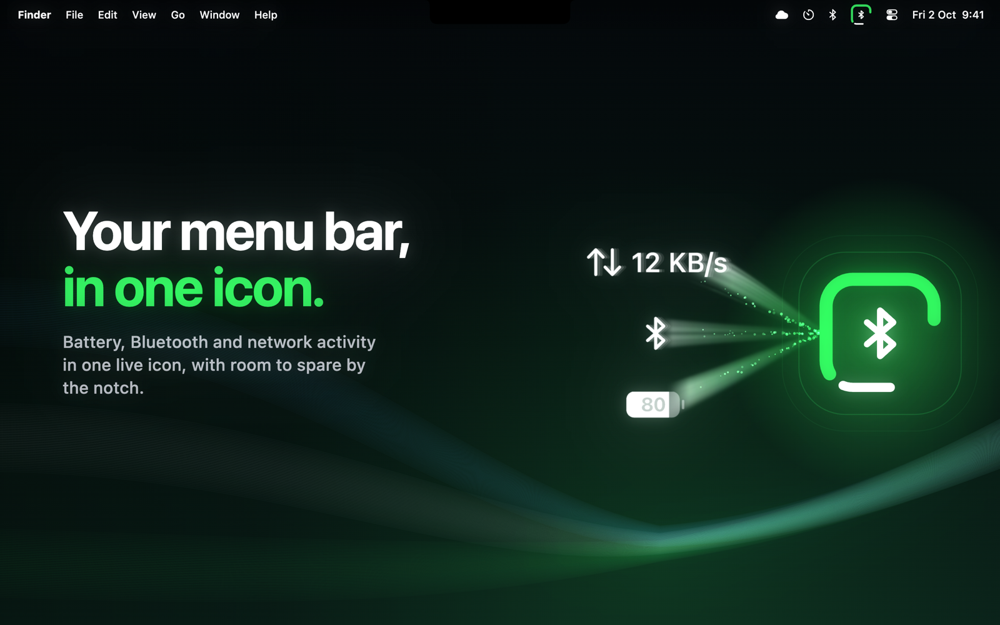
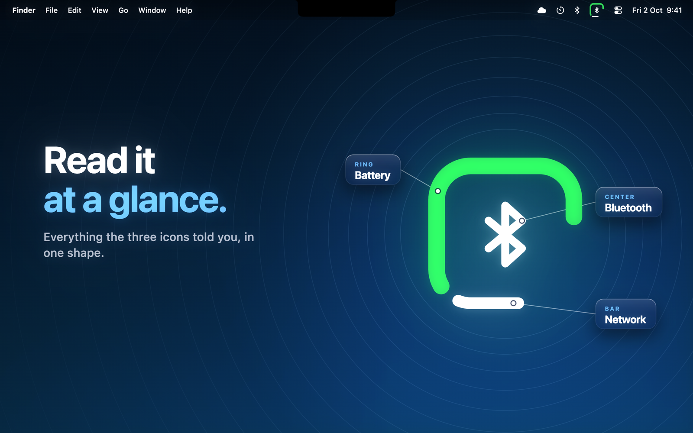
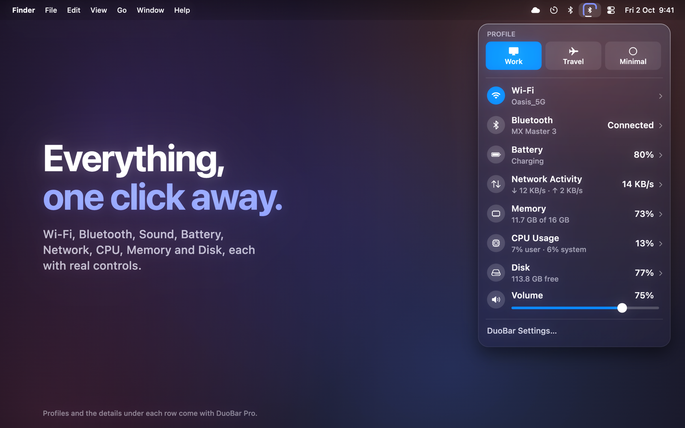
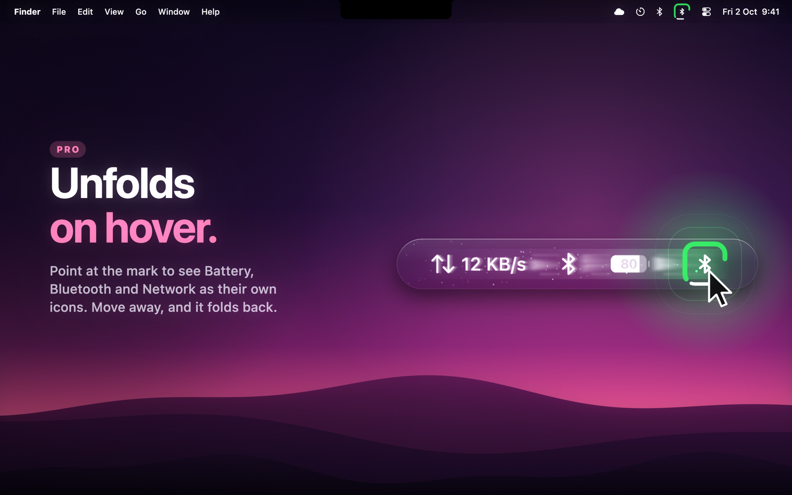
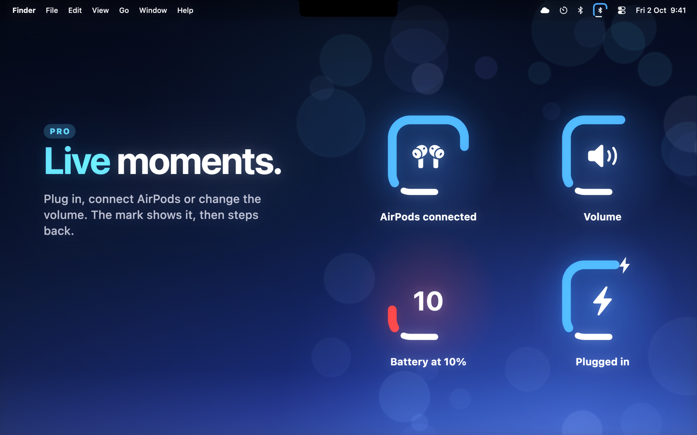
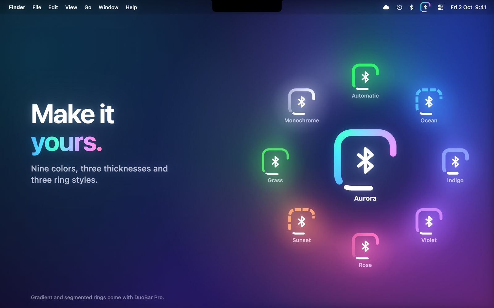
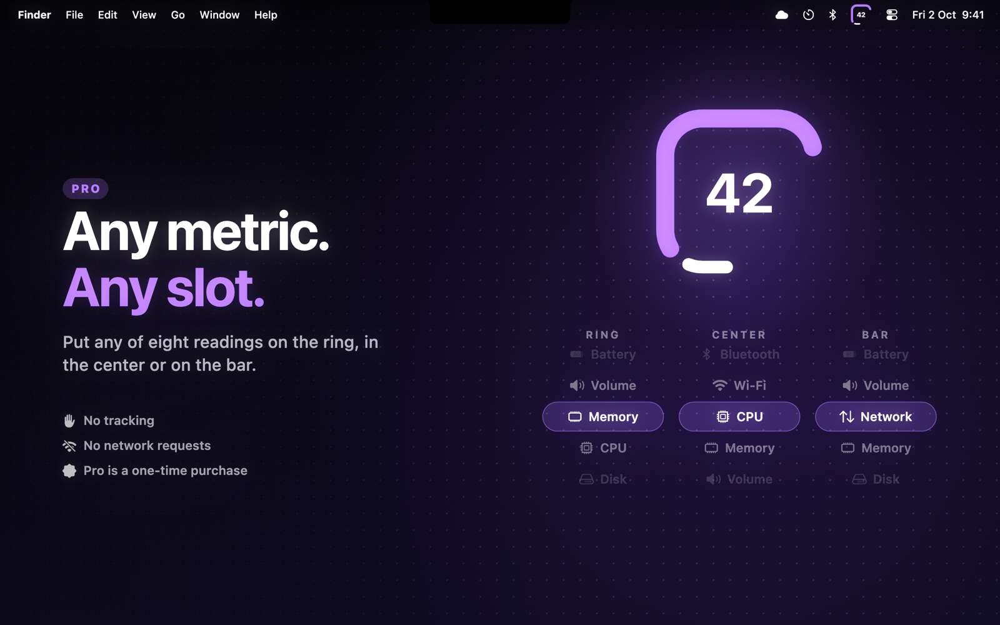

# DuoBar: a notch-friendly battery, Wi-Fi and system monitor for the Mac menu bar

**DuoBar is a macOS menu bar app that shows your battery, Wi-Fi and network activity in one small live icon.** The icon is a ring, a center glyph and four dots. Click it to see battery, Wi-Fi, Bluetooth, volume, display, network, memory, CPU and disk, each with its own controls. It needs macOS 14 or later, and it's free to download with an optional one-time Pro upgrade.

[**Download DuoBar on the Mac App Store**](https://apps.apple.com/app/duobar/id6812335628) · [Website](https://www.teekamsuthar.com/duobar) · [Privacy policy](PRIVACY.md)

> This repository holds DuoBar's public documentation, screenshots and release notes. The app's source code is private.

## What DuoBar does

Most menu bar monitors add another row of icons. On a MacBook with a notch, those icons get hidden behind the camera housing. DuoBar replaces several icons with one, so the space next to the notch stays free.

- **One icon, three readings.** The outer ring shows one metric (battery by default), the center glyph shows another (Wi-Fi), and the four dots show a third (network activity).
- **A popover with everything.** Click the icon for a list of Battery, Wi-Fi, Bluetooth, Volume, Display, Network, Memory, CPU and Disk. Each row opens a page with controls.
- **No Dock icon and no windows.** Only the mark in the menu bar.
- **Private.** No analytics, no tracking and no network requests of its own. Everything is read on your Mac through Apple's public APIs.

## The popover

| Page | What you get |
| --- | --- |
| Wi-Fi | Turn Wi-Fi on or off and see the networks around you |
| Bluetooth | Paired devices with their battery levels |
| Sound | Volume slider and output device picker |
| Display | Keep Awake for a set time or until you turn it off, mirroring, each display's resolution and refresh rate |
| Battery | Time remaining, Low Power Mode, maximum capacity and cycle count |
| Network | Download and upload graph for the last minute |
| CPU | Usage graph, load averages, thermal state and uptime |
| Memory | App, Wired, Compressed and Cached, the way Activity Monitor splits it |
| Disk | Free space on every volume |

You can rest the pointer on the icon to open the popover without clicking, and choose which rows it shows.

## Free and Pro

**Free** includes the default mark (Battery ring, Wi-Fi center, network activity dots) in Automatic or Monochrome colors, every ring thickness, icon size, an optional percentage on the ring, hover to open the popover, launch at login, and the full popover with all its pages.

**DuoBar Pro** is a one-time purchase with no subscription. It adds:

- Any of eight metrics in any slot: Battery, Wi-Fi, Bluetooth, Volume, Network, Memory, CPU or Disk
- Hover to unfold the mark into a separate icon for each reading
- Live moments: the mark briefly shows plugging in, a full charge, low battery, Low Power Mode, AirPods taking over, muting, joining a Wi-Fi network, a dropped connection or a drive connecting
- Seven colors (Ocean, Indigo, Violet, Rose, Sunset, Grass, Aurora), gradient and segmented rings, tracks, and the Grow and Snap dot styles
- Profiles such as Everyday, Work and Focus, switchable from the popover
- Reordering the popover's rows and a details line under each reading
- Switching Wi-Fi networks and Bluetooth devices from the popover (experimental)

You can try all of Pro free for 7 days. Nothing is charged and nothing renews. When the trial ends, the free mark comes back.

## FAQ

### Does DuoBar fix menu bar icons hidden behind the notch?

DuoBar doesn't move other apps' icons. It frees space by combining battery, Wi-Fi and network activity into one icon, so fewer icons compete for room next to the notch.

### Can I see battery percentage in the menu bar?

Yes. Turn on the percentage and it shows at the top of the ring. It's free.

### Can DuoBar show CPU, memory and disk usage in the menu bar?

Yes. The popover shows CPU, memory and disk for free. With Pro you can also put CPU, memory, disk, network, volume or Bluetooth on the ring, center or dots of the menu bar icon itself.

### Does DuoBar replace the system Wi-Fi, Sound, Battery and Bluetooth menu bar icons?

It's built to. The mark draws the states the system Wi-Fi icon does, and the popover carries the controls of those system menus, so you can hide the originals.

### Which Macs and macOS versions does it support?

macOS 14 (Sonoma) or later.

### Is DuoBar free?

It's free to download and use with the default mark. Pro is a single one-time in-app purchase, and there's a 7-day free trial of Pro.

### Does DuoBar collect data?

No. It has no analytics, no telemetry and no crash reporting, and makes no network requests of its own. Wi-Fi network names need Location permission because macOS treats them as location data. DuoBar uses it only to read the names and never reads your location. If you decline, everything else still works. See the [privacy policy](PRIVACY.md).

### Does it use a lot of CPU or battery?

It's built to be light. It reads only the metrics you can see, and the icon redraws only when something changes.

### Why is it called DuoBar?

The default mark pairs two things, battery and Wi-Fi, in one status icon, plus network activity on the dots. Apple's iPhone Duo combines its status icons into one, and DuoBar brings that idea to the Mac menu bar. DuoBar isn't affiliated with Apple.

## Compared with other menu bar tools

| | DuoBar | Typical system monitor | Menu bar manager |
| --- | --- | --- | --- |
| Goal | Replace several icons with one | Add an icon or text per metric | Hide or rearrange existing icons |
| Battery, Wi-Fi, network in one icon | Yes | Usually separate items | No |
| Controls in the popover (Wi-Fi, Bluetooth, volume, Keep Awake) | Yes | Varies | No |
| Pricing | Free, optional one-time Pro | Varies | Varies |

DuoBar works alongside tools like Stats, iStat Menus and menu bar managers. If you need a full hardware dashboard with sensors and fan control, a dedicated monitor does more. If you want one compact icon that tells you the state of your Mac at a glance, that's what DuoBar is for.

## Requirements

- macOS 14 (Sonoma) or later
- Location permission is optional and used only to show Wi-Fi network names

## Releases

See [Releases](../../releases) for version notes.

## Support and feedback

Open an [issue](../../issues) for bugs or feature requests, or visit [teekamsuthar.com/duobar](https://www.teekamsuthar.com/duobar).

## About

DuoBar is made by [Teekam Suthar](https://www.teekamsuthar.com). It isn't affiliated with Apple. Mac, macOS, MacBook and iPhone are trademarks of Apple Inc.
